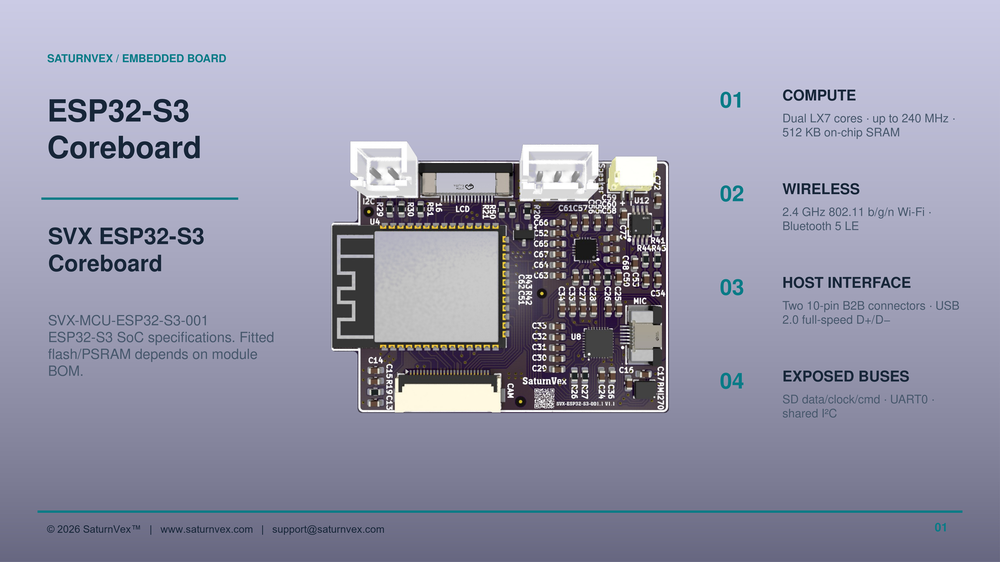
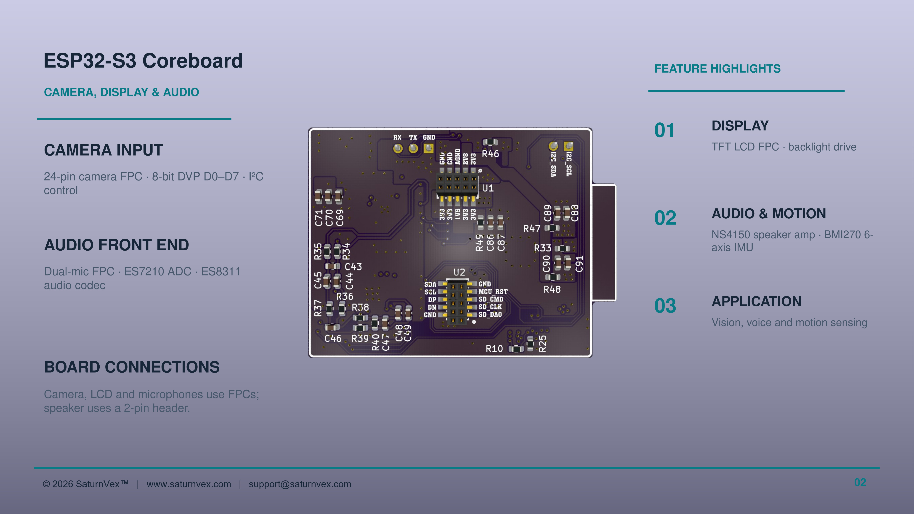
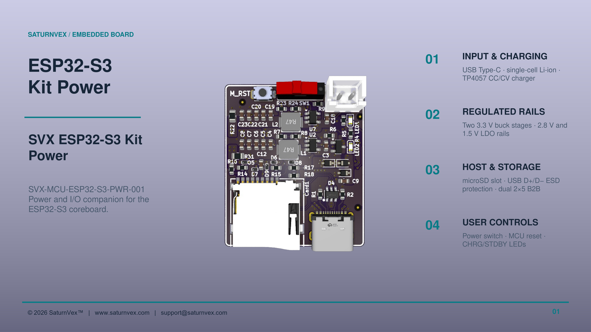
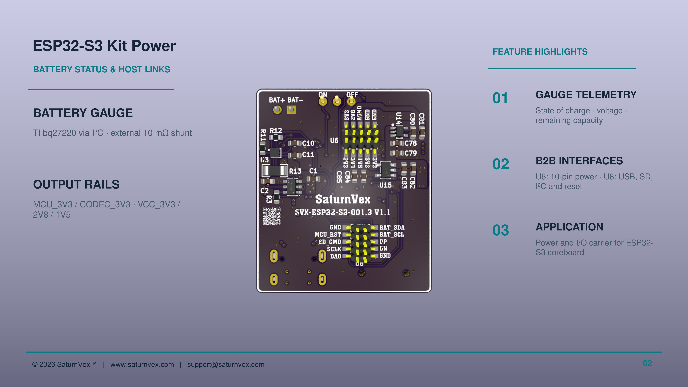
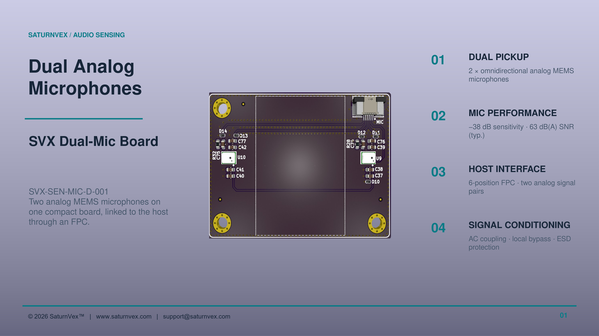
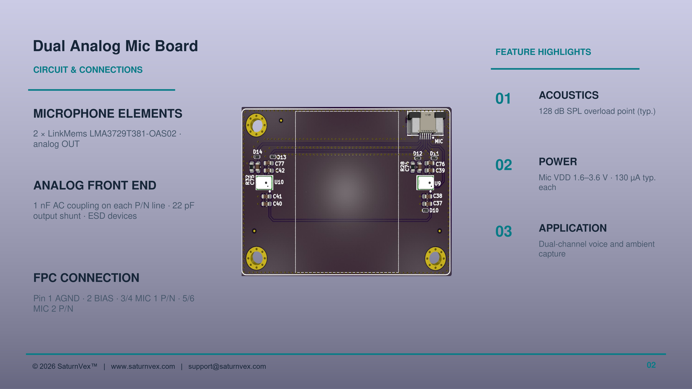
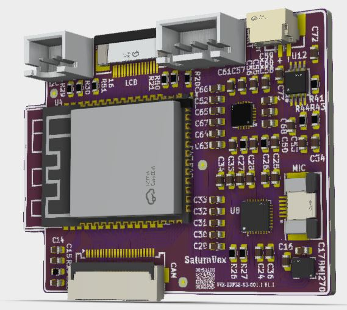
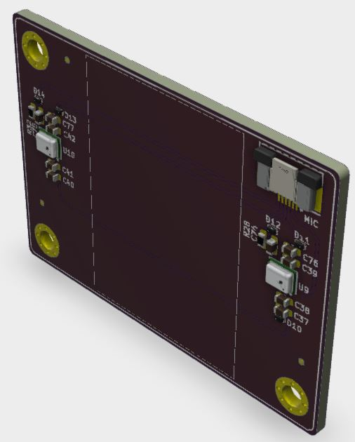
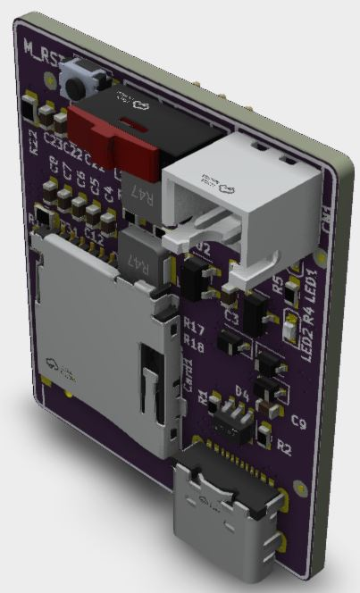

<strong>SATURNVEX · ESP32-S3 AUDIO, VOICE & EDGE AI</strong>

<!-- Product cover images; GitHub constrains content to the README panel width. -->

# SVX-ESP32-S3 — Development Kit

*SaturnVex™ — embedded hardware, firmware and Edge AI platforms*

A compact three-board ESP32-S3 kit for audio, voice and IoT development: an ESP32-S3 core board with Wi-Fi / Bluetooth LE, audio codecs and IMU, a dual analog microphone / speaker board, and a power board with Li-ion charging, regulated rails and microSD.

The kit is not limited to the supplied examples: the shared I²C, UART, SD and USB signals on the board-to-board connectors can be reused for other applications.

## Product specifications

| Item | Specification |
|---|---|
| Product code | `SVX-ESP32-S3-001` |
| MCU | Espressif ESP32-S3 (ESP32-S3-WROOM-1 module), dual Xtensa LX7 up to 240 MHz, 512 KB on-chip SRAM |
| External memory | 8 MB octal PSRAM (used by the audio and voice examples) |
| Wireless | 2.4 GHz 802.11 b/g/n Wi-Fi, Bluetooth 5 LE |
| Audio | ES8311 DAC + NS4150 speaker amplifier (4 Ω / 3 W speaker path); ES7210 ADC with two analog MEMS microphones |
| Sensors | Bosch BMI270 6-axis IMU (I²C, address 0x68) |
| Storage | microSD slot, SDMMC 1-bit (CLK GPIO17, CMD GPIO8, D0 GPIO18) |
| Host interface | Native USB 2.0 full-speed (USB Serial/JTAG on GPIO19 / GPIO20) for programming and console; UART TX on GPIO43 |
| Power board | USB Type-C input, single-cell Li-ion charging (TP4057), two 3.3 V buck stages, 2.8 V and 1.5 V LDO rails, power switch, reset, CHRG / STDBY LEDs |
| Board dimensions | **Core board 39 × 51 mm · microphone / speaker board 42 × 56 mm · power board 32 × 36 mm** |
| Software | ESP-IDF v6.1, VS Code with the Espressif ESP-IDF extension |
| Test projects provided | Wi-Fi AP / STA HTTP, BLE multi-client, BMI270 IMU UART, microSD read / write, SD MP3 player, real-time karaoke audio with AEC, voice-controlled MP3 player (MultiNet7) |

## Documentation

| Resource | File |
|---|---|
| **ESP-IDF toolchain setup guide** | [Open PDF](docs/SaturnVex_ESP32S3_ESP-IDF_Toolchain_Setup_Guide_EN.pdf) |
| **Firmware test guides and source projects** | [Browse tests](tests/README.md) |
| **Mechanical CAD (three PCBs)** | [CAD files / STEP](cad/README.md) |
| **Download all available documentation and code** | [Download complete package](downloads/SVX-ESP32-S3-001_Complete_Resources.zip) |

## Test projects — documentation paired with source

| Test | Test guide (PDF) | Source (ZIP) | Overview |
|---|---|---|---|
| 01 — BLE Multi-Client (NimBLE GATT) | [Guide](tests/01-ble-multiclient/SaturnVex_ESP32S3_BLE_MultiClient_Test_Guide_EN.pdf) | [Source](tests/01-ble-multiclient/ESP32S3_BLE_MultiClient_Test_SaturnVex.zip) | [Open](tests/01-ble-multiclient/README.md) |
| 02 — BMI270 IMU to UART | [Guide](tests/02-bmi270-uart/SaturnVex_ESP32S3_BMI270_UART_Test_Guide_EN.pdf) | [Source](tests/02-bmi270-uart/ESP32S3_BMI270_UART_Test_SaturnVex.zip) | [Open](tests/02-bmi270-uart/README.md) |
| 03 — microSD Read / Write | [Guide](tests/03-sd-card/SaturnVex_ESP32S3_SD_Card_Test_Guide_EN.pdf) | [Source](tests/03-sd-card/ESP32S3_SD_Card_Test_SaturnVex.zip) | [Open](tests/03-sd-card/README.md) |
| 04 — SD Card MP3 Player | [Guide](tests/04-sd-mp3-player/SaturnVex_ESP32S3_SD_MP3_Player_Test_Guide_EN.pdf) | [Source](tests/04-sd-mp3-player/ESP32S3_SD_MP3_Player_Test_SaturnVex.zip) | [Open](tests/04-sd-mp3-player/README.md) |
| 05 — Real-Time Karaoke Audio with AEC | [Guide](tests/05-karaoke-aec/SaturnVex_ESP32S3_Karaoke_AEC_Test_Guide_EN.pdf) | [Source](tests/05-karaoke-aec/ESP32S3_Karaoke_AEC_Test_SaturnVex.zip) | [Open](tests/05-karaoke-aec/README.md) |
| 06 — Voice-Controlled MP3 Player (MultiNet7) | [Guide](tests/06-voice-mp3-multinet7/SaturnVex_ESP32S3_Voice_MP3_MultiNet7_Test_Guide_EN.pdf) | [Source](tests/06-voice-mp3-multinet7/ESP32S3_Voice_MP3_MultiNet7_Test_SaturnVex.zip) | [Open](tests/06-voice-mp3-multinet7/README.md) |
| 07 — Wi-Fi AP / STA HTTP | [Guide](tests/07-wifi-ap-sta/SaturnVex_ESP32S3_WiFi_AP_STA_Test_Guide_EN.pdf) | [Source](tests/07-wifi-ap-sta/ESP32S3_WiFi_AP_STA_Test_SaturnVex.zip) | [Open](tests/07-wifi-ap-sta/README.md) |

**Getting started:** Read the [ESP-IDF Toolchain Setup Guide](docs/SaturnVex_ESP32S3_ESP-IDF_Toolchain_Setup_Guide_EN.pdf) before building or flashing. Each test project has its own setup and acceptance criteria. Projects are built with ESP-IDF v6.1; audio and voice projects download their Espressif managed components automatically on the first build.

## CAD data

| Board | PCB outline | STEP model |
|---|---|---|
| ESP32-S3 core board | 39 × 51 mm | [STEP](cad/SVX_ESP32_S3_001_CoreBoard.step) |
| Microphone / speaker board | 42 × 56 mm | [STEP](cad/SVX_ESP32_S3_001_MicSpeakerBoard.step) |
| Power board | 32 × 36 mm | [STEP](cad/SVX_ESP32_S3_001_PowerBoard.step) |

## Complete download

[**Download all supplied documentation, STEP CAD, and seven paired example projects**](downloads/SVX-ESP32-S3-001_Complete_Resources.zip).

You can alternatively use **Code → Download ZIP** in GitHub to download the repository.

## Where to Buy

For availability, pricing and purchase inquiries, contact **[support@saturnvex.com](mailto:support@saturnvex.com)**.

## Notes

- The PDFs describe specific test setups and expected results, not a blanket certification claim.
- SaturnVex source files are provided under the BSD-3-Clause license (`LICENSE.txt` in each project). Espressif ESP-IDF, Espressif managed components and the Bosch BMI270 SensorAPI keep their own licenses (`NOTICE.txt`); preserve all third-party notices when redistributing firmware. Some Espressif components (esp-sr, esp_audio_codec) may only be used with Espressif chips.
- All board I/O is 3.3 V logic. Do not apply 5 V to any GPIO.
- Start audio tests at a low volume and keep the speaker away from the microphones.

---
© 2026 **SaturnVex™** · [www.saturnvex.com](https://www.saturnvex.com) · support@saturnvex.com
