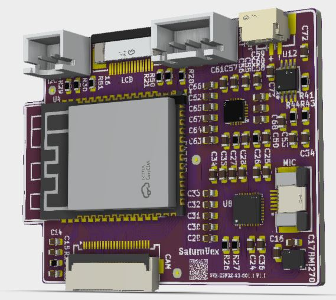
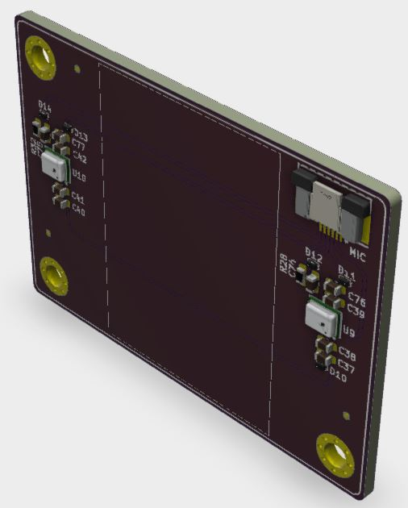
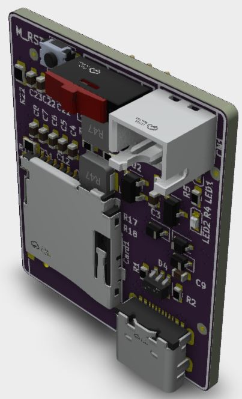

# Mechanical CAD

The kit consists of three PCBs that are stacked into one assembly. Dimensions are the nominal PCB outlines (length × width); verify connector mating, stack height and mounting clearances from the STEP models.

| Board | PCB outline | STEP model | Rendering |
|---|---|---|---|
| ESP32-S3 core board | 39 × 51 mm | [Download STEP](SVX_ESP32_S3_001_CoreBoard.step?raw=true) | [View](SVX_ESP32_S3_001_CoreBoard_CAD_3D_View.jpg) |
| Microphone / speaker board | 42 × 56 mm | [Download STEP](SVX_ESP32_S3_001_MicSpeakerBoard.step?raw=true) | [View](SVX_ESP32_S3_001_MicSpeakerBoard_CAD_3D_View.jpg) |
| Power board | 32 × 36 mm | [Download STEP](SVX_ESP32_S3_001_PowerBoard.step?raw=true) | [View](SVX_ESP32_S3_001_PowerBoard_CAD_3D_View.jpg) |

[← Product home](../README.md)
